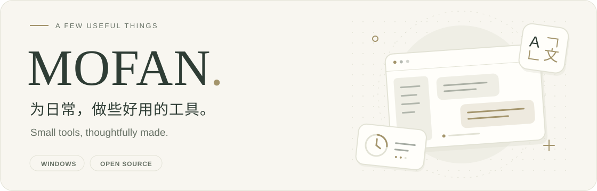
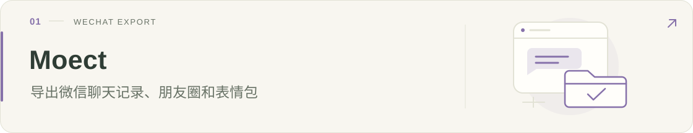
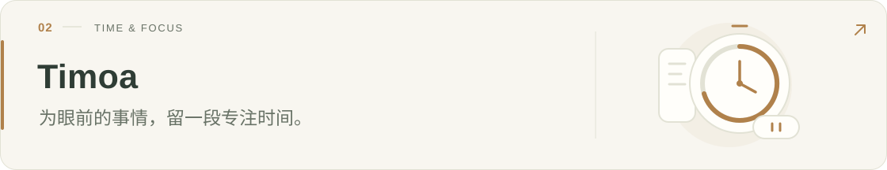
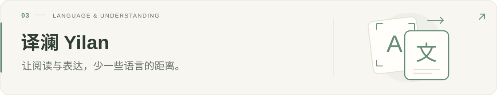
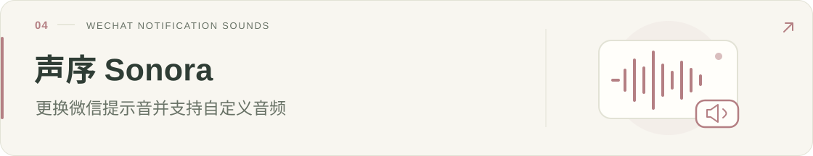
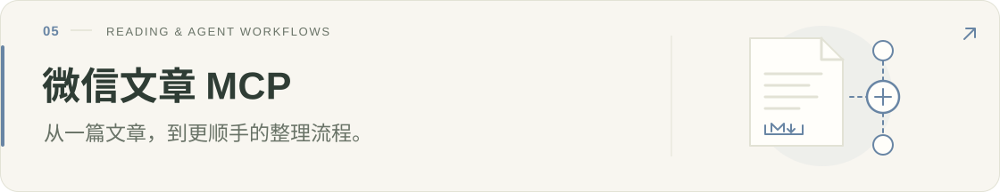
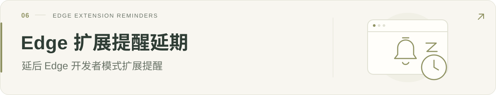
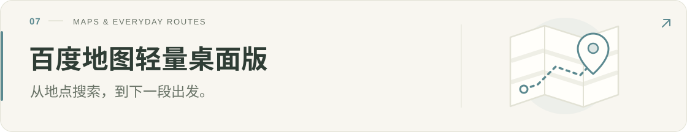

<picture>
  <source media="(prefers-color-scheme: dark)" srcset="assets/header-dark.svg" />
  <source media="(prefers-color-scheme: light)" srcset="assets/header-light.svg" />
  
</picture>

你好，我是 **MOFAN**。

我主要在这里分享自己开发的 Windows 工具和开源项目。可以在下面查看项目、下载软件，有问题可以到对应仓库提交 Issue。

Windows utilities and open-source projects. Browse the projects and downloads below.

## 作品 · Selected work

下面是各个项目的介绍和下载链接。

<a href="https://github.com/mofan6/Moect">
<picture>
  <source media="(prefers-color-scheme: dark)" srcset="assets/project-moect-dark.svg" />
  <source media="(prefers-color-scheme: light)" srcset="assets/project-moect-light.svg" />
  
</picture>
</a>

导出本机微信会话、朋友圈和表情包，支持多种格式、批量任务、搜索与时间筛选。导出的 HTML 可以离线浏览。

[**Moect** · 查看项目](https://github.com/mofan6/Moect)　·　[下载使用](https://github.com/mofan6/Moect/releases/latest)

 

<a href="https://github.com/mofan6/Timoa">
<picture>
  <source media="(prefers-color-scheme: dark)" srcset="assets/project-timoa-dark.svg" />
  <source media="(prefers-color-scheme: light)" srcset="assets/project-timoa-light.svg" />
  
</picture>
</a>

Windows 计时工具，提供倒计时、秒表、闹钟和悬浮计时窗口。

[**Timoa** · 查看项目](https://github.com/mofan6/Timoa)　·　[下载使用](https://github.com/mofan6/Timoa/releases/latest)

 

<a href="https://github.com/mofan6/Yilan">
<picture>
  <source media="(prefers-color-scheme: dark)" srcset="assets/project-yilan-dark.svg" />
  <source media="(prefers-color-scheme: light)" srcset="assets/project-yilan-light.svg" />
  
</picture>
</a>

支持离线翻译、截图 OCR、图片翻译和文档翻译，在 Windows 本机运行。

[**译澜 Yilan** · 查看项目](https://github.com/mofan6/Yilan)　·　[下载使用](https://github.com/mofan6/Yilan/releases/latest)

 

<a href="https://github.com/mofan6/Sonora">
<picture>
  <source media="(prefers-color-scheme: dark)" srcset="assets/project-sonora-dark.svg" />
  <source media="(prefers-color-scheme: light)" srcset="assets/project-sonora-light.svg" />
  
</picture>
</a>

更换 Windows 微信的通知提示音，支持内置铃声、自定义 WAV、备份和恢复。

[**声序 Sonora** · 查看项目](https://github.com/mofan6/Sonora)　·　[下载使用](https://github.com/mofan6/Sonora/releases/latest)

 

<a href="https://github.com/mofan6/wechat-article-mcp">
<picture>
  <source media="(prefers-color-scheme: dark)" srcset="assets/project-mcp-dark.svg" />
  <source media="(prefers-color-scheme: light)" srcset="assets/project-mcp-light.svg" />
  
</picture>
</a>

通过 MCP 将微信公众号文章导出为 Markdown 和 PDF，供 Agent 读取和处理。

[**微信文章 MCP** · 查看项目](https://github.com/mofan6/wechat-article-mcp)

 

<a href="https://github.com/mofan6/edge-extension-snooze">
<picture>
  <source media="(prefers-color-scheme: dark)" srcset="assets/project-edge-dark.svg" />
  <source media="(prefers-color-scheme: light)" srcset="assets/project-edge-light.svg" />
  
</picture>
</a>

为 Microsoft Edge 开发者模式扩展提醒设置延期，支持配置发现、备份和撤销。

[**Edge 扩展提醒延期** · 查看项目](https://github.com/mofan6/edge-extension-snooze)　·　[下载使用](https://github.com/mofan6/edge-extension-snooze/releases/latest)

 

<a href="https://github.com/mofan6/BaiduMapsDesktop">
<picture>
  <source media="(prefers-color-scheme: dark)" srcset="assets/project-maps-dark.svg" />
  <source media="(prefers-color-scheme: light)" srcset="assets/project-maps-light.svg" />
  
</picture>
</a>

基于百度地图网页版的 Windows 桌面客户端，支持地点搜索、路线规划、收藏和区域截图。

[**百度地图轻量桌面版** · 查看项目](https://github.com/mofan6/BaiduMapsDesktop)　·　[下载使用](https://github.com/mofan6/BaiduMapsDesktop/releases/latest)

 

## 交流 · Say hello

使用中遇到问题或有功能建议，请在对应项目的 **Issues** 中反馈。

Please report bugs and feature requests in the relevant project's Issues.

<picture>
  <source media="(prefers-color-scheme: dark)" srcset="assets/closing-dark.svg" />
  <source media="(prefers-color-scheme: light)" srcset="assets/closing-light.svg" />
  
</picture>

